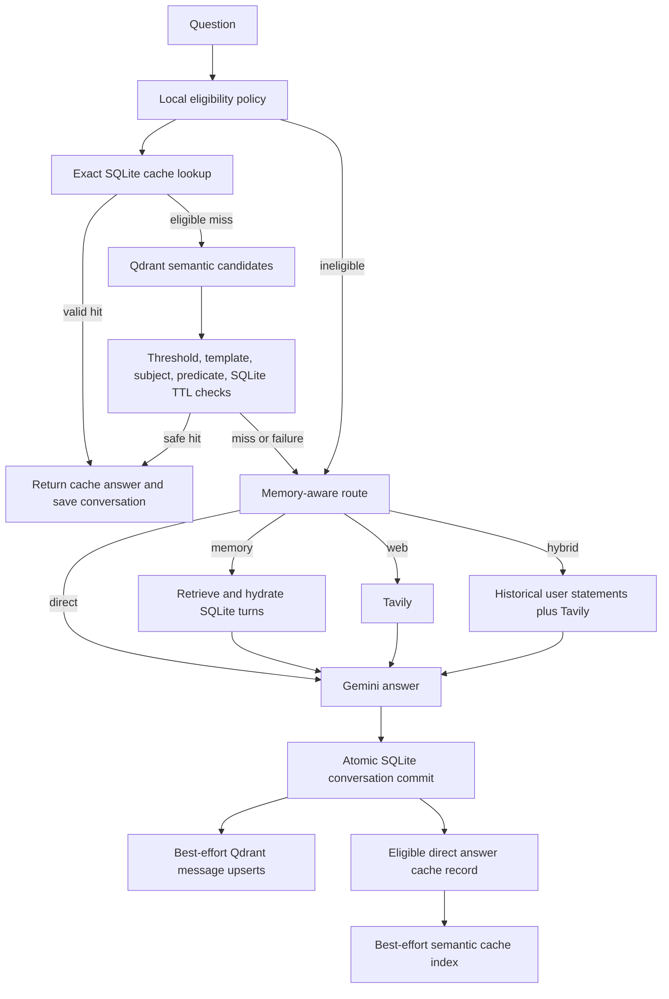

# SearchMind design

## Components and boundaries

The existing CLI → agent → memory/retriever/web-search architecture is preserved.
`app/cache.py` adds a local policy and answer-cache coordinator. SQLite holds
original messages and authoritative cache records. Qdrant remains a replaceable
semantic index. Gemini produces answers; Tavily is the sole external search tool.
No LangGraph or additional runtime dependency is introduced.

## Cache identity, equivalence, and lifetime

`answer_cache` stores UUID, normalized question, answer, eligibility key, namespace,
creation time, and expiry. Question normalization only changes case and whitespace.
Namespace hashes cache policy version plus generation/embedding model identifiers.
A unique question/namespace pair updates the same canonical UUID on refresh.
`answer_cache_aliases` maps accepted semantic wordings to that UUID, making their
next request an exact lookup. Foreign keys delete aliases with canonical records.

The `searchmind_answer_cache` collection indexes canonical question embeddings;
payloads contain canonical ID and namespace, not an alternative answer authority.
A semantic candidate must clear the configured threshold (0.92 by default) and
resolve to a live SQLite record whose approved intent/subject/predicate matches.
Unknown modifications, numbers, extra qualifiers, and negation fail the closed
question grammar. Subject names are not stemmed or merged; similar words cannot
silently change an entity. Candidate score alone never authorizes an answer.

Only a small stable-subject allowlist is eligible, and only direct answers generated
without history/memory can be saved. Credential/personal-data markers, uncertainty,
insufficient evidence, URLs, and temporal answer language cause rejection. Memory,
web, hybrid, follow-up, personal, and time-sensitive questions bypass the cache.
No additional LLM call is used to decide eligibility or semantic equivalence.

Validity requires both the stored expiry and the current configured maximum TTL.
Invalidating a SQLite record makes stale vector references harmless immediately.
Changing `CACHE_VERSION`, model identifiers, or disabling caching gives operational
invalidation. Physical vector cleanup is intentionally separate and manual.

## Routing

The agent checks cache before history retrieval, embedding creation, or Gemini.
Recognized safe knowledge templates route directly. Personal/historical language
routes to memory; when combined with current external verification language it
routes to hybrid. Historical relative dates alone stay on the memory route.
Current external questions route to web. Courtesy phrases such as “tell me” do not
by themselves imply personal history. Ambiguous requests retain the existing Gemini
router, extended to accept `hybrid`. An invalid router response falls back to web.

Only memory/hybrid routes search conversation vectors. Direct/web requests avoid
unrelated long-term memories. Recent same-session history is available for ambiguous
follow-ups, but omitted completely for cache-eligible generation. Cache routes make
zero Gemini/Tavily calls; recognized non-cache routes make one answer call. Ambiguous
routes may require an additional router call.

Hybrid web queries include relevant original user statements to identify historical
versions. Prior assistant text cannot supply historical facts to the Tavily query.
All retrieved content is untrusted context. The answer prompt distinguishes user
history, unverified assistant text, and fresh web evidence, and requires acknowledging
missing/conflicting history and citing web sources. These are prompt-level controls,
not independent verification of the LLM output.

## Conversation persistence and indexing

`messages` preserves original message IDs, session IDs, roles, content, timestamps,
and adds `turn_id`. Old messages get missing UUIDs/default sessions and conservative
adjacent pairing within sessions. New question/answer turns commit in one SQLite
transaction before any Qdrant writes. Session history remains scoped; semantic
retrieval intentionally spans sessions belonging to this single local user.

Both roles receive vector points keyed by message UUID. Results are hydrated from
SQLite, not trusted payload text; missing original rows are dropped. Retrieval
requires a minimum similarity and lexical topic overlap against the original user
message. Results deduplicate by turn and include paired messages and timestamps.
Assistant answers remain marked untrusted. Credential-bearing rows are not indexed.

`memory_index(message_id, index_key)` records acknowledged upserts. The index key
includes URL, collection, and embedding model. `backfill` scans bounded pending
batches, uses stable UUID upserts, and marks each success afterward. Failures retain
SQLite originals and pending status. A crash after a successful upsert but before
marking produces an idempotent retry. Cache-hit conversations skip immediate
indexing and can be backfilled later. Sensitive rows are marked skipped by backfill
so repeated batches make progress.

The model is loaded lazily and reused process-wide. One lazy vector-store client
serves both collections. Collection dimensions are checked on first use. A collection
must be renamed when changing models, including same-dimension replacements.
External collection deletion requires a new indexing namespace (new collection name)
for full rebuild. Failed semantic cache writes preserve working exact entries but
are not included in conversation backfill.

## Failure handling and observability

Cache/vector lookup failures are misses, not fatal answer errors. Index failures
occur only after durable SQLite persistence. There is no promise of atomicity across
SQLite and Qdrant, no automatic background worker, and no loss of original turns due
to a vector-service failure. SQLite failures propagate rather than claiming data was
saved. Live answer API failures still surface as failed requests.

Optional debug output includes cache kind, numerical retrieval scores/counts, route,
API names, indexing status, and elapsed wall time. It excludes prompts, questions,
answers, keys, URLs, payloads, and raw SDK exceptions. The normal CLI prints answers
and user-requested history. Configuration/key validation is lazy for API clients,
allowing offline exact hits and tests without credentials.

## Validation, setup, and constraints

See README for `uv` setup, `.env` options, persistent Qdrant startup, CLI commands,
cache invalidation, and test commands. `requirements-dev.txt` adds pytest only.
Tests use fake embeddings, local in-memory Qdrant, temporary SQLite databases,
and mocked external APIs. They verify adversarial identical-vector candidates,
cache lifetime/alias invalidation, restart persistence, routing, cross-session
turn hydration, partial-write recovery, and zero unnecessary API/model calls.

The narrow grammar reduces hit rate; lexical memory filtering sacrifices recall
for precision. Cached general knowledge is not independently fact-checked. Pattern
filters cannot recognize every secret or personal detail. Routing is heuristic;
relative time and memory conflicts are interpreted by Gemini rather than SQL.
Expired vectors can crowd candidate results (a safe miss). Runtime model downloads,
remote services, multilingual phrasing, and real-world semantic calibration need
separate live validation. The current application assumes one local user, not a
multi-tenant service.
